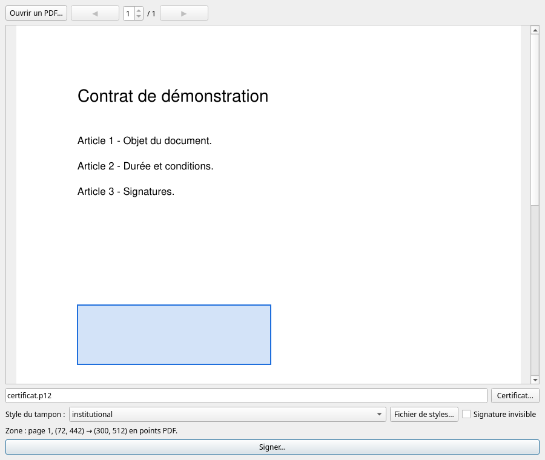

# Signa

[Français](#français) · [English](#english)

## Français

Signa est une application de bureau (Linux, Windows, macOS) pour **signer des PDF** avec un
certificat PKCS#12 (`.p12` / `.pfx`) grâce à [pyHanko](https://pyhanko.readthedocs.io/).



- Ouvrir un PDF (sélecteur, glisser-déposer, « Ouvrir avec ») et le parcourir page par page.
- Tracer à la souris le rectangle de signature (converti en coordonnées PDF entières, origine en bas à gauche).
- Choisir le certificat et un style de tampon défini dans un fichier YAML pyHanko ; option « signature invisible ».
- Le résultat est enregistré sous `<nom>-signe.pdf` à côté de l'original, **sans jamais l'écraser**. Un PDF déjà signé reçoit une signature supplémentaire.
- Le dernier certificat, le style et la zone sont mémorisés. Le **mot de passe n'est jamais stocké** : il est demandé à chaque signature.

### ⚠️ Valeur juridique de la signature

Avec un certificat **auto-signé** (créé par vous-même), la signature prouve que le document **n'a pas été modifié**
après la signature (intégrité), mais **elle n'a pas la valeur d'une signature électronique qualifiée** et
l'identité du signataire n'est pas garantie : les lecteurs PDF afficheront « identité inconnue ».
Pour une valeur juridique (contrats, marchés publics, etc.), utilisez un certificat délivré par une
**autorité de certification reconnue** (par exemple un prestataire de services de confiance qualifié eIDAS).
Signa ne fournit ni horodatage par tiers de confiance, ni validation à long terme.

### Installation

Les installateurs sont **non signés** (pas de certificat de signature de code) : Windows et macOS afficheront un
avertissement la première fois. Téléchargez-les depuis la page [Releases](https://github.com/simetriik/signa/releases).

#### Linux — Debian 13 (trixie)

```sh
sudo apt install ./signa_0.1.0-1_amd64.deb
```

Les dépendances système sont installées automatiquement ; pyHanko et ses bibliothèques sont embarqués.
Le menu « Ouvrir avec » des PDF propose Signa. Désinstallation : `sudo apt remove signa`.

Autres distributions : voir « Depuis les sources » ci-dessous.

#### Windows 10/11 — `Signa-0.1.0.msi`

1. Double-cliquez sur le `.msi`.
2. **SmartScreen** affiche « Windows a protégé votre ordinateur » : cliquez sur **Informations complémentaires**, puis sur **Exécuter quand même**.
3. Suivez l'assistant. Signa apparaît dans le menu Démarrer et dans « Ouvrir avec » pour les PDF.

#### macOS (Apple silicon) — `Signa-0.1.0.dmg`

1. Ouvrez le `.dmg` et glissez **Signa** dans **Applications**.
2. Au premier lancement, **Gatekeeper** refuse d'ouvrir l'application (développeur non identifié). Ouvrez **Réglages Système → Confidentialité et sécurité**, descendez jusqu'au message sur Signa et cliquez sur **Ouvrir quand même** (macOS 15 et plus). Sur macOS 14 et moins : clic droit sur l'application → **Ouvrir** → **Ouvrir**.
3. Alternative en terminal : `xattr -dr com.apple.quarantine /Applications/Signa.app`.

#### Depuis les sources (tous systèmes)

Nécessite [uv](https://docs.astral.sh/uv/) et Python 3.13.

```sh
git clone https://github.com/simetriik/signa.git && cd signa
uv sync
uv run signa [document.pdf]
./scripts/install-user-launcher.sh   # Linux, optionnel : lanceur GNOME pour votre utilisateur
```

### Utilisation

1. Lancez **Signa**, ou `signa document.pdf`, ou clic droit sur un PDF → « Ouvrir avec Signa ».
2. Choisissez votre certificat (« Certificat… »).
3. Tracez le rectangle de signature sur la page voulue (ou cochez « Signature invisible »).
4. Choisissez le style du tampon, cliquez sur « Signer… » et saisissez le mot de passe.
5. Le fichier `<nom>-signe.pdf` est créé ; le bouton « Ouvrir le résultat » l'affiche.

### Styles de tampon

Au premier lancement, un fichier `pyhanko.yml` est créé dans le dossier de configuration de votre système
(`~/.config/signa/` sous Linux, `%APPDATA%\signa\` sous Windows, `~/Library/Application Support/signa/` sous macOS)
à partir de [`src/signa/resources/pyhanko.example.yml`](src/signa/resources/pyhanko.example.yml).
Modifiez-le (textes « Prénom NOM », etc.) ou choisissez un autre fichier via « Fichier de styles… ».
Le format est celui de la section `stamp-styles` de pyHanko ; pour une police personnalisée, ajoutez `font: "/chemin/police.ttf"` sous `text-box-style`.

### Développement

```sh
uv sync
uv run pytest
uv run python scripts/make_screenshots.py   # régénère les captures (mode offscreen)
```

Les tests génèrent un certificat et un PDF factices. Voir [CONTRIBUTING.md](CONTRIBUTING.md).
Construire les installateurs : [CONTRIBUTING.md](CONTRIBUTING.md#installateurs).

### Limites connues

- Les pages avec rotation sont gérées pour les coordonnées de la zone, mais l'orientation du texte du tampon n'est pas corrigée.
- Signature simple (CMS) : pas d'horodatage par autorité tierce (TSA) ni de validation à long terme.
- Un PDF protégé par mot de passe n'est pas ouvert.
- Installateurs non signés ; Windows et macOS n'ont pas été testés par l'auteur avant la 0.1.0.

### Sécurité et licence

Voir [SECURITY.md](SECURITY.md). Licence : [GPL-3.0-or-later](LICENSE). Les bibliothèques tierces embarquées dans les installateurs gardent leurs propres licences.

---

## English

Signa is a desktop app (Linux, Windows, macOS) to **sign PDF files** with a PKCS#12
(`.p12` / `.pfx`) certificate, powered by [pyHanko](https://pyhanko.readthedocs.io/).


- Open a PDF (file picker, drag and drop, "Open with") and browse it page by page.
- Draw the signature rectangle with the mouse (converted to integer PDF coordinates, origin at bottom-left).
- Pick the certificate and a stamp style defined in a pyHanko YAML file; "invisible signature" option.
- The result is saved as `<name>-signe.pdf` next to the original, **never overwriting it**. An already-signed PDF gets an additional signature.
- The last certificate, style and area are remembered. The **password is never stored**: it is asked on every signing.

The user interface is in French.

### ⚠️ Legal value of the signature

With a **self-signed** certificate (one you created yourself), the signature proves the document **has not been
altered** since signing (integrity), but it **does not have the value of a qualified electronic signature**, and the
signer's identity is not vouched for: PDF readers will show "unknown identity". For legal value (contracts, public
procurement…), use a certificate issued by a **recognised certificate authority** (e.g. an eIDAS qualified trust
service provider). Signa provides neither third-party timestamping nor long-term validation.

### Installation

The installers are **unsigned** (no code-signing certificate), so Windows and macOS show a warning on first run.
Download them from the [Releases](https://github.com/simetriik/signa/releases) page.

- **Linux (Debian 13)**: `sudo apt install ./signa_0.1.0-1_amd64.deb` — remove with `sudo apt remove signa`. Other distributions: run from source.
- **Windows 10/11**: run `Signa-0.1.0.msi`. When **SmartScreen** shows "Windows protected your PC", click **More info**, then **Run anyway**.
- **macOS (Apple silicon)**: open `Signa-0.1.0.dmg` and drag Signa to Applications. **Gatekeeper** blocks the first launch: go to **System Settings → Privacy & Security**, find the message about Signa and click **Open Anyway** (macOS 15+). On macOS 14 and earlier: right-click the app → **Open** → **Open**. Terminal alternative: `xattr -dr com.apple.quarantine /Applications/Signa.app`.
- **From source** (all systems, needs [uv](https://docs.astral.sh/uv/) and Python 3.13): `git clone https://github.com/simetriik/signa.git && cd signa && uv sync && uv run signa [file.pdf]`.

### Usage

Launch Signa, choose your certificate, draw the rectangle (or tick "Signature invisible"), pick a stamp style, click "Signer…" and enter the password. Stamp styles live in `pyhanko.yml` inside your OS configuration folder (`~/.config/signa/`, `%APPDATA%\signa\`, `~/Library/Application Support/signa/`), created from [`pyhanko.example.yml`](src/signa/resources/pyhanko.example.yml), using pyHanko's `stamp-styles` format.

### Development

`uv sync && uv run pytest` — tests use a generated dummy certificate and PDF. See [CONTRIBUTING.md](CONTRIBUTING.md).

### Known limitations

Rotated pages: area coordinates are handled, stamp text orientation is not corrected. Plain CMS signature only (no third-party timestamping or long-term validation). Password-protected PDFs are not opened. Installers are unsigned.

### Security and license

See [SECURITY.md](SECURITY.md). License: [GPL-3.0-or-later](LICENSE). Third-party libraries bundled in the installers keep their own licenses.
